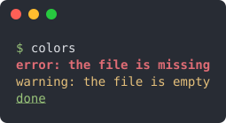

# Cookbook

Short answers to "how do I ...?". Each recipe is a complete program with its real output; the [reference](/guide/features#feature-map) has the details.

[[toc]]

## Print a string

<<< @/examples/snippets/print_string.f90

<<< @/examples/output/print_string.ansi{ansi}

`//''` is the idiom used in all these pages: it works wherever a `character` is expected.

## Assign, concatenate, compare

<<< @/examples/snippets/operators.f90

<<< @/examples/output/operators.ansi{ansi}

`//` gives a `character`, `.cat.` a `string`; the comparisons accept a `character` on either side.

## Change the case

<<< @/examples/snippets/letter_case.f90

<<< @/examples/output/letter_case.ansi{ansi}

## camelCase, snake_case, Start Case

<<< @/examples/snippets/wordcase.f90

<<< @/examples/output/wordcase.ansi{ansi}

The words are separated by blanks, or by `sep`.

## Remove blanks, or other characters, around a string

<<< @/examples/snippets/strip.f90

<<< @/examples/output/strip.ansi{ansi}

`strip` removes the blanks at both ends, or the characters of the set `remove`; `lstrip` and `rstrip` one end only.
`whitespace=.true.` removes tabs, new lines and the other whitespace too, as Python `str.strip()`.

## Replace, collapse, insert

<<< @/examples/snippets/replace.f90

<<< @/examples/output/replace.ansi{ansi}

## Tidy whitespace, repeats, tabs and quotes

<<< @/examples/snippets/tidy.f90

<<< @/examples/output/tidy.ansi{ansi}

`compact` collapses whitespace, `squeeze` repeated characters, `expand_tabs` aligns on tab stops, `transliterate` maps a
set of characters onto another; `quote` and `unquote` add and remove quotes, doubling the inner ones.

## Tell letters, digits, punctuation and blanks apart

<<< @/examples/snippets/char_classes.f90

<<< @/examples/output/char_classes.ansi{ansi}

Each test is true if all the characters of the string are in the class, false for a null string.

## Split a line into words

<<< @/examples/snippets/split_words.f90

<<< @/examples/output/split_words.ansi{ansi}

Repeated separators count as one, and the ones at the ends are ignored. `max_tokens` is the number of splits. To keep
the empty fields, as in a CSV record, pass `keep_empty=.true.`.

## Join an array of strings

<<< @/examples/snippets/join_strings.f90

<<< @/examples/output/join_strings.ansi{ansi}

`join` is a method, its string is the default separator; `strjoin` is a function of the module.

## Parse comma-separated values

<<< @/examples/snippets/csvline.f90

<<< @/examples/output/csvline.ansi{ansi}

`keep_empty=.true.` keeps the empty cell in its column, and `read_number` reports, with a positive `iostat`, a cell that
is not a number instead of returning 0 or NaN.

## Split a very long string

<<< @/examples/snippets/split_big.f90

<<< @/examples/output/split_big.ansi{ansi}

`split_chunked` gives the tokens of `split`, working through the string in `chunks` pieces, which saves memory on very
long strings. Repeated separators are collapsed.

## Split once, at the first separator

<<< @/examples/snippets/partition.f90

<<< @/examples/output/partition.ansi{ansi}

## Take a part of a string

<<< @/examples/snippets/slice.f90

<<< @/examples/output/slice.ansi{ansi}

`slice` returns a `character`; its three arguments are all optional.

## Reverse the characters, or the words

<<< @/examples/snippets/reverse.f90

<<< @/examples/output/reverse.ansi{ansi}

## Pad to a width

<<< @/examples/snippets/pad.f90

<<< @/examples/output/pad.ansi{ansi}

## Center or justify in a width

<<< @/examples/snippets/align.f90

<<< @/examples/output/align.ansi{ansi}

`center`, `ljust` and `rjust` work as the Python methods: a string already as wide as the width is unchanged.

## Find something in a string

<<< @/examples/snippets/search.f90

<<< @/examples/output/search.ansi{ansi}

`count` and `index` look for occurrences that do not overlap, as Python: `'aaaa'` holds 2 `'aa'`, 3 with
`overlapping=.true.`. `index(substring, occurrence=k)` is the k-th occurrence, counted from the end with `back=.true.`,
0 if there are fewer.

## Read the settings of a key = value file

<<< @/examples/snippets/regex_keyvalue.f90

<<< @/examples/output/regex_keyvalue.ansi{ansi}

`match` anchors the pattern at the start of each line; `[^#]*?` is lazy, so the trailing blanks and the comment are
left to the rest of the pattern. See [Regular Expressions](/guide/regex).

## Extract the numbers of a text

<<< @/examples/snippets/regex_numbers.f90

<<< @/examples/output/regex_numbers.ansi{ansi}

`re_findall` returns the text of every match; the pattern takes a sign, a fraction and an exponent, and `(?:...)`
groups without capturing, so `findall` returns the whole matches.

## Rename files that follow a pattern

<<< @/examples/snippets/regex_rename.f90

<<< @/examples/output/regex_rename.ansi{ansi}

`sub` rebuilds the name from the groups `\1` to `\4`; `nsub` tells whether the pattern matched, so the other names are
left alone. To rename for real, pass the two names to `rename` (a common extension) or to `execute_command_line`.

## Search or replace once, without compiling

<<< @/examples/snippets/regex_calls-oneoff.f90

<<< @/examples/output/regex_calls.ansi{ansi}

`re_search`, `re_fullmatch`, `re_findall`, `re_split` and `re_sub` take the subject first and the pattern as a character,
compiled at each call: in a loop, compile a `regex` once and pass it instead. A malformed pattern stops the program;
compile it yourself with `iostat` to handle the error.

## Check that a whole string has a shape

<<< @/examples/snippets/regex_calls-whole.f90

`search` finds the pattern anywhere, `match` only at the start, `fullmatch` and `re_fullmatch` only on the whole string:
that is the one for validating input.

## Work with the groups of a match

<<< @/examples/snippets/regex_calls-groups.f90

`group_count` and `group_index` ask the regex; `groups` returns the texts of all the groups of a match, and a group that
did not take part is a not allocated string, not an empty one.

## Ignore case, match lines, and catch a bad pattern

<<< @/examples/snippets/regex_calls-flags.f90

`i` ignores the ASCII case, `m` makes `^` and `$` match at each line, `s` lets the dot match a line feed; they go in
`flags`, or at the start of the pattern. With `iostat` a malformed pattern gives the byte of the error and leaves the
regex not compiled (`is_compiled`), and such a regex matches nothing.

## Get the text between two tags

<<< @/examples/snippets/tags.f90

<<< @/examples/output/tags.ansi{ansi}

`search` returns the first tagged text, tags included, and optionally where it starts and ends.

## Check whether a string is a number

<<< @/examples/snippets/number_check.f90

<<< @/examples/output/number_check.ansi{ansi}

`is_digit` is true when every character is a digit; a real has a decimal point or an exponent, so an integer is not a real.

## Convert a string to a number

<<< @/examples/snippets/number_cast.f90

<<< @/examples/output/number_cast.ansi{ansi}

Check first: on a string that is not a number `to_number` gives 0 (integer kinds) or NaN (real kinds).

## Convert a string to a number, with an error status

<<< @/examples/snippets/checked_cast.f90

<<< @/examples/output/checked_cast.ansi{ansi}

`read_number` reports the failure as a `read` statement: `iostat` is positive and `iomsg` says why.

## Convert a number to a string

<<< @/examples/snippets/number_string.f90

<<< @/examples/output/number_string.ansi{ansi}

A real is written with all the significant digits of its kind. `hex` reads the integer in the string.

## Read a whole file

<<< @/examples/snippets/readfile.f90

<<< @/examples/output/readfile.ansi{ansi}

The first form is a subroutine of the module, the second a method reading the file as one string, line ends included.

## Read a file line by line

<<< @/examples/snippets/readline.f90

<<< @/examples/output/readline.ansi{ansi}

`iostat` is zero for every line read, empty ones included, and not zero at the end of the file.

## Read a file saved by a Windows editor

<<< @/examples/snippets/bom_file-read.f90

<<< @/examples/output/bom_file.ansi{ansi}

<<< @/examples/output/bom_file-od.ansi{ansi}

Some editors start a UTF-8 file with a byte order mark, the bytes EF BB BF (`357 273 277` in octal): read as is, they
are the first three characters of the first line, so a key or a number there is not found. `skip_bom=.true.` drops
them (the module subroutines `read_file` and `read_lines` take it too), `has_bom()` tells whether a string starts with
them, and `write_file(..., bom=.true.)` writes them.

## Write a file

<<< @/examples/snippets/writefile.f90

<<< @/examples/output/writefile.ansi{ansi}

<<< @/examples/output/writefile-cat.ansi{ansi}

## Write and read lines through an open unit

<<< @/examples/snippets/unit_io.f90

<<< @/examples/output/unit_io.ansi{ansi}

`write_line` writes a string as one line, `write_lines` writes each line it holds as a line. `read_lines` rewinds the
unit and reads every line: as a method into one string, as the procedure of the module into an array.

## Save strings in a binary file

<<< @/examples/snippets/binary_io.f90

<<< @/examples/output/binary_io.ansi{ansi}

An unformatted `write` stores each string as its length followed by its characters, and `read` gets it back exactly,
blanks and empty strings included. The format is the same as that of `string_type` in the Fortran stdlib.

## Read strings from the standard input

<<< @/examples/snippets/read_stdin.f90

<<< @/examples/output/read_stdin.ansi{ansi}

A list-directed `read` takes one blank-delimited word, or a quoted text, for each string.

## Take a path apart

<<< @/examples/snippets/paths.f90

<<< @/examples/output/paths.ansi{ansi}

## List the files matching a pattern

<<< @/examples/snippets/glob.f90

<<< @/examples/output/glob.ansi{ansi}

`glob` runs the `ls` command: it works on Unix-like systems only. Only the wildcards `*`, `?` and `[...]` are special:
any other character of the pattern is part of the names searched.

## Filter names with a wildcard pattern

<<< @/examples/snippets/wildcards.f90

<<< @/examples/output/wildcards.ansi{ansi}

`match` needs no file system: it works on any system, on names already in memory, and it is elemental.

## Get a name for a temporary file

<<< @/examples/snippets/tempname.f90

<<< @/examples/output/tempname.ansi{ansi}

The name is not used by any file of the directory; it changes at each call, so the example prints what does not.

## Wrap a paragraph in justified lines

<<< @/examples/snippets/justify.f90

<<< @/examples/output/justify.ansi{ansi}

The last line is left-justified and padded; a word longer than the width stays alone on its line.

## Find what several strings start with

<<< @/examples/snippets/prefix.f90

<<< @/examples/output/prefix.ansi{ansi}

## Compare two version numbers

<<< @/examples/snippets/version.f90

<<< @/examples/output/version.ansi{ansi}

Fields of digits are compared as integers of any size, the others as text. It is not semantic versioning: `1.0.0-rc1` is greater than `1.0.0`.

## Sort an array of strings

<<< @/examples/snippets/sorting-orders.f90

<<< @/examples/snippets/sorting-permutation.f90

<<< @/examples/snippets/sorting-custom.f90

<<< @/examples/output/sorting.ansi{ansi}

`strsort` is a stable sort in place. `less` chooses the order: `strless`, the default, is byte order; `strless_natural`
puts `run2` before `run10`; `strless_nocase` ignores the ASCII case; or write your own pure function with the interface
`strsort_less`. `index` returns the permutation, so that other arrays can follow the strings.

## Encode and decode in base64

<<< @/examples/snippets/encode_base64.f90

<<< @/examples/output/encode_base64.ansi{ansi}

## Escape a character

<<< @/examples/snippets/escape.f90

<<< @/examples/output/escape.ansi{ansi}

## Escape text for XML or HTML

<<< @/examples/snippets/xml_escape-write.f90

<<< @/examples/snippets/xml_escape-read.f90

<<< @/examples/output/xml_escape.ansi{ansi}

`escape_xml` protects `& < > " '`; pass `attribute=.true.` for an attribute value, so that its line ends survive.
`unescape_xml` reads the entities back, and `xml_error` gives the byte of the first malformed reference: `&nbsp;` is one,
as XML does not define it.

## Log any bytes readably

<<< @/examples/snippets/c_escapes-log.f90

<<< @/examples/snippets/c_escapes-errors.f90

<<< @/examples/output/c_escapes.ansi{ansi}

`escape_c` writes any bytes as printable ASCII and `unescape_c` reads them back exactly; `escapes_error` gives the byte
of the first malformed escape. See [8. Unicode text](./tutorial/08-unicode).

## Print in colour

<<< @/examples/snippets/colors.f90

## A method on every element of an array

<<< @/examples/snippets/arrays.f90

<<< @/examples/output/arrays.ansi{ansi}

The elements of an array of strings have each its own length.

## Use the Fortran intrinsics on a string

<<< @/examples/snippets/intrinsics.f90

<<< @/examples/output/intrinsics.ansi{ansi}

`adjustl`, `adjustr`, `count`, `index`, `len_trim`, `repeat`, `scan`, `trim` and `verify` accept a string. `trim` removes the trailing blanks only.
